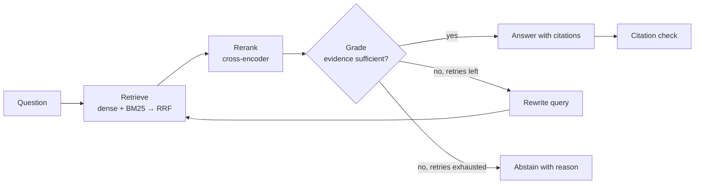

# HALO — Grounded Knowledge Engine

HALO answers questions over a hard corpus of 1,000 arXiv research papers. It **only answers when the papers support the answer**, cites where each claim comes from, and **abstains** when the corpus can't back an answer up.

> Status: **M0 — setup and data audit.** No retrieval or generation code yet. Every number in this README will come from a results file in [`results/`](results/) produced by the eval harness — nothing is quoted from memory.

## What it does

Given a question, HALO:

1. **Retrieves** candidate passages with hybrid search: dense embeddings and BM25 keyword search, fused with Reciprocal Rank Fusion.
2. **Reranks** the candidates with a cross-encoder.
3. **Grades** whether the evidence actually answers the question.
4. **Corrects itself**: if the evidence is insufficient, it rewrites the query and retrieves again (at most 2 retries).
5. **Answers with citations** (paper, section, page) — or **abstains** with a reason when the evidence never becomes sufficient.
6. **Verifies** that every cited passage supports the sentence that cites it.



## Why it's built this way

Most RAG demos show that retrieval *works*. HALO is built to show that it is *measured*: the evaluation harness comes before any optimization, and each stage (baseline → hybrid → rerank → corrective loop → grounded citations) must show a measured before/after on the same fixed question set. Abstention is a first-class behavior, tested on questions whose source papers are deliberately never indexed.

## Benchmark

[Vectara Open RAG Bench](https://huggingface.co/datasets/vectara/open_ragbench) ([GitHub](https://github.com/vectara/open-rag-bench)), arXiv subset, official release:

- 1,000 papers: 396 papers with questions + 604 distractors
- 3,045 questions, labeled extractive/abstractive and by modality (text, text+image, text+table, text+table+image)
- Section-level relevance labels: exactly one relevant section per question

The MVP parses text only, so **text-modality questions are the primary metric**; image/table questions are still evaluated and reported separately so the gap is visible. Dataset formats as actually inspected are documented in [`DATA.md`](DATA.md); design choices and their justifying numbers in [`DECISIONS.md`](DECISIONS.md).

## Stack

Python 3.12 (uv) · LangGraph · Ollama (`qwen3:8b`, `nomic-embed-text`) · Qdrant (embedded) · BM25 · sentence-transformers cross-encoder · PyMuPDF · FastAPI · pytest. Fully local; runs on a 6 GB laptop GPU.

## Quickstart (M0)

```bash
uv sync
uv run python scripts/download_data.py         # HF metadata, parsed corpus, 1,000 arXiv PDFs (resumable)
uv run python scripts/audit_data.py            # check counts against the published numbers
uv run python scripts/make_splits.py --check   # verify committed splits reproduce byte-identically
uv run pytest
```

## Roadmap

| Milestone | Scope |
|---|---|
| **M0** | Setup, data audit, fixed evaluation splits |
| M1 | PDF ingestion, section-aware chunking, dense index |
| M2 | Eval harness (retrieval, answer, abstention metrics) + naive baseline |
| M3 | Hybrid retrieval (BM25 + dense, RRF) + cross-encoder reranking |
| M4 | LangGraph corrective loop + abstention |
| M5 | Inline citations + grounding check |
| M6 | Full corpus, API/CLI, final results |

## Results

_Populated from `results/` as milestones complete._
