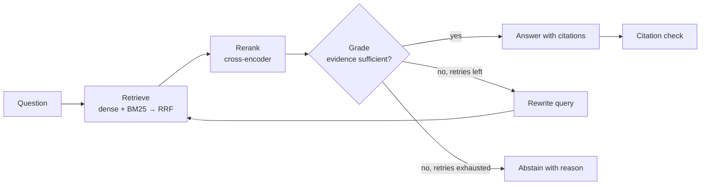

# HALO — Grounded Knowledge Engine

HALO answers questions over a hard corpus of 1,000 arXiv research papers. It **only answers when the papers support the answer**, cites where each claim comes from, and **abstains** when the corpus can't back an answer up.

> Every number in this README comes from a file in [`results/`](results/): the tables are generated by `uv run python -m eval.report.readme`, and the analysis below them quotes [`results/m6_report.md`](results/m6_report.md). Nothing is quoted from memory.

## What it does

Given a question, HALO:

1. **Retrieves** candidate passages with hybrid search: dense embeddings and BM25 keyword search, fused with Reciprocal Rank Fusion.
2. **Reranks** the candidates with a cross-encoder.
3. **Grades** whether the evidence actually answers the question.
4. **Corrects itself**: if the evidence is insufficient, it rewrites the query and retrieves again (at most 2 retries).
5. **Answers with citations** (paper, section, page) — or **abstains** with a reason when the evidence never becomes sufficient.
6. **Verifies** that every cited passage supports the sentence that cites it.



## Why it's built this way

Most RAG demos show that retrieval *works*. HALO is built to show that it is *measured*: the evaluation harness comes before any optimization, and each stage (baseline → hybrid → rerank → corrective loop → grounded citations) must show a measured before/after on the same fixed question set. Abstention is a first-class behavior, tested on questions whose source papers are deliberately never indexed.

## Benchmark

[Vectara Open RAG Bench](https://huggingface.co/datasets/vectara/open_ragbench) ([GitHub](https://github.com/vectara/open-rag-bench)), arXiv subset, official release:

- 1,000 papers: 396 papers with questions + 604 distractors
- 3,045 questions, labeled extractive/abstractive and by modality (text, text+image, text+table, text+table+image)
- Section-level relevance labels: exactly one relevant section per question

The MVP parses text only, so **text-modality questions are the primary metric**; image/table questions are still evaluated and reported separately so the gap is visible. Dataset formats as actually inspected are documented in [`DATA.md`](DATA.md); design choices and their justifying numbers in [`DECISIONS.md`](DECISIONS.md).

## Stack

Python 3.12 (uv) · LangGraph · Ollama (`qwen3:8b`, `nomic-embed-text`) · Qdrant (embedded) · BM25 · sentence-transformers cross-encoder · PyMuPDF · FastAPI · pytest. Fully local; runs on a 6 GB laptop GPU.

## Quickstart

Needs [uv](https://docs.astral.sh/uv/) and [Ollama](https://ollama.com/). A CUDA GPU is optional: on a CPU-only machine set `[rerank] device = "auto"` in `config/default.toml` (reranking is ~30× slower on CPU).

```bash
git clone https://github.com/lunatictiol/halo && cd halo
uv sync
ollama pull qwen3:8b && ollama pull nomic-embed-text

uv run python scripts/download_data.py          # HF metadata + parsed corpus + 1,000 arXiv PDFs (~1 h, resumable)
uv run python scripts/ingest.py --split full    # chunk + embed the 980 indexable papers into embedded Qdrant (~1-2 h)

uv run python -m halo.cli "What datasets are used to evaluate the proposed method?"
uv run uvicorn halo.api.app:app                 # POST /query {"question": "..."}, GET /health
```

For a faster try-out, `scripts/ingest.py --split dev_slice` indexes the 100-paper dev slice and `python -m halo.cli --collection dev_slice "..."` queries it.

`POST /query` returns:

```json
{"answer": "... [2406.01234v2 §4 p.6].", "abstained": false, "abstain_reason": null,
 "citations": [{"paper_id": "2406.01234v2", "section_id": 4, "section_title": "Experiments", "page": 6}],
 "retries": 0}
```

### Reproducing the evaluation

```bash
uv run pytest
uv run python -m eval.runners.run --split dev_sample --pipeline graph --name m6_graph   # also: abstention_set, full
uv run python -m eval.report.readme                                                      # regenerate the tables below
```

Runs checkpoint per question under `data/runs/` and resume after an interruption. M1-M5 results were measured on the 100-paper dev index; add `--collection dev_slice` to reproduce them.

## Results

<!-- results:start -->

<!-- Generated by `uv run python -m eval.report.readme`; do not edit by hand. -->

### Progression on `dev_sample` (303 answerable questions)

| Stage | Change | Run | R@5 | MRR | Correct | Correct (text) | Faithful | False-abst | Abstention ↑ | Cite valid | Median s/q |
|---|---|---|---|---|---|---|---|---|---|---|---|
| M2 baseline | dense top-5 → answer | [`m2_baseline`](results/m2_baseline_dev_sample.json) | 0.868 | 0.707 | 0.848 | 0.868 | 0.975 | 0.063 | 0.875 | – | 11.4 |
| M3 hybrid | + BM25, RRF fusion (retrieval only) | [`m3_retrieval_hybrid`](results/m3_retrieval_hybrid_dev_sample.json) | 0.908 | 0.759 | – | – | – | – | – | – | – |
| M3 rerank | + cross-encoder rerank | [`m3_hybrid_rerank`](results/m3_hybrid_rerank_dev_sample.json) | 0.944 | 0.830 | 0.908 | 0.951 | 0.987 | 0.020 | 0.809 | – | 14.6 |
| M4 loop | + grade → rewrite → retry, abstain | [`m4_graph_v2`](results/m4_graph_v2_dev_sample.json) | 0.937 | 0.820 | 0.908 | 0.946 | 0.986 | 0.033 | 0.882 | – | 16.2 |
| M5 grounded | + citations, grounding check | [`m5_check_v2`](results/m5_check_v2_dev_sample.json) | 0.937 | 0.820 | 0.901 | 0.941 | 0.986 | 0.040 | 0.862 | 0.976 | 26.7 |
| M6 full corpus | same pipeline, 980-paper index | [`m6_graph`](results/m6_graph_dev_sample.json) | 0.927 | 0.806 | 0.898 | 0.931 | 0.990 | 0.043 | 0.776 | 0.974 | 25.8 |

Correct = LLM-judged correct vs the reference (a refusal counts as wrong). Faithful = answered questions judged supported by the retrieved context. False-abst = answerable questions refused. Abstention ↑ = share of `abstention_set` (152 questions whose papers are never indexed) correctly refused. Cite valid = generator citations whose passages support their sentence. R@5 and MRR are against the single gold section, on the top-5 the answer was generated from. Judge and generator are both `qwen3:8b`.

### Scaling to the full corpus

| Slice | n dev_sample | n full | Dev index, dev_sample: R@5 | Dev index, dev_sample: Correct | Full index, dev_sample: R@5 | Full index, dev_sample: Correct | Full index, full: R@5 | Full index, full: Correct |
|---|---|---|---|---|---|---|---|---|
| overall | 303 | 2891 | 0.937 | 0.901 | 0.927 | 0.898 | 0.917 | 0.841 |
| type: extractive | 124 | 1198 | 0.968 | 0.887 | 0.952 | 0.887 | 0.938 | 0.864 |
| type: abstractive | 179 | 1693 | 0.916 | 0.911 | 0.911 | 0.905 | 0.901 | 0.825 |
| modality: text | 204 | 1801 | 0.961 | 0.941 | 0.951 | 0.931 | 0.945 | 0.907 |
| modality: text-image | 72 | 736 | 0.875 | 0.806 | 0.861 | 0.819 | 0.847 | 0.709 |
| modality: text-table | 13 | 143 | 0.923 | 0.769 | 0.923 | 0.769 | 0.938 | 0.769 |
| modality: text-table-image | 14 | 211 | 0.929 | 0.929 | 0.929 | 0.929 | 0.905 | 0.791 |

Abstention rate on `abstention_set`: dev index 0.862, full index 0.776. Sources: [`m5_check_v2_*`](results/), [`m6_graph_*`](results/).

### Examples

<details><summary>Rewrite loop rescued a failed first retrieval (7 on <code>dev_sample</code>, 5 shown, from <code>m4_graph_v2</code>)</summary>

### `3738d2b7-fe0b-412a-bdf7-c88a0f0e4aee` (abstractive, text-image)

- **Question:** How are filamentary coils approximated in discrete optimization?
- **Attempt 1 grade:** insufficient: The passages discuss the approximation of filamentary coils using wireframe segments and mention that space curves are approximated as polygons, but they do not explicitly explain how filamentary coils are approximated in discrete optimization.
- **Rewrite 1:** `How are filamentary coils modeled as polygonal chains in discrete optimization algorithms?`
- **Gold in top-5:** first attempt yes, final no (MRR 1.00 → 0.12)
- **Answer:** Filamentary coils are approximated in discrete optimization by using wireframe current paths that consist of interconnected wire segments. These paths, while containing sharp, angular turns, serve as a starting point for more realistic coil designs and can be refined using optimization techniques such as FOCUS, DESC, GOSPEL, or SIMSOPT.
- **Reference:** Filamentary coils are often approximated as polygons, where space curves are represented by straight wire segments. This simplification allows for easier calculation of magnetic fields using methods like the Biot-Savart law.

### `6a149c18-c83d-4faa-8210-bbd6e598216b` (abstractive, text-image)

- **Question:** How does graph Laplacian coupling contribute to understanding pattern formations?
- **Attempt 1 grade:** insufficient: The passages discuss graph Laplacian coupling in the context of pattern formation and its role in modeling spatial dynamics, but they do not explicitly explain how graph Laplacian coupling contributes to understanding pattern formations.
- **Rewrite 1:** `What is the mechanism by which graph Laplacian coupling facilitates the analysis of pattern formation in spatially extended systems?`
- **Gold in top-5:** first attempt yes, final yes (MRR 1.00 → 1.00)
- **Answer:** Graph Laplacian coupling contributes to understanding pattern formation by enabling the study of spatial dynamics in discrete models, where it replaces diffusion and allows for the emergence of spatially periodic patterns, similar to those observed in continuous reaction-diffusion systems. This coupling facilitates the analysis of stability and bifurcations, providing insights into the conditions under which patterns can form.
- **Reference:** Graph Laplacian coupling helps model spatial relationships and connectivity between elements within a system. It aids in understanding how local and global interactions contribute to emergent patterns like those observed in animal skin or plant structures.

### `83dda238-c421-4f22-aec5-7c6c83875eb3` (abstractive, text)

- **Question:** What does it mean for an element to be in the lidentity of itself?
- **Attempt 1 grade:** insufficient: The passages discuss the concept of left identity and related sets in semigroup theory, but they do not directly address the meaning of an element being in the 'lidentity of itself'.
- **Rewrite 1:** `What is the definition of an element being in the left identity of itself in semigroup theory?`
- **Gold in top-5:** first attempt yes, final yes (MRR 0.33 → 0.50)
- **Answer:** For an element to be in the lidentity of itself, it means that the element is an idempotent. This is because an element $ e $ is in $ lidentity(e) $ if and only if $ e $ is an idempotent, i.e., $ ee = e $.
- **Reference:** An element \(e\) is in the lidentity of itself if and only if it is an idempotent.

### `86997f53-2801-4007-a0e4-de847455b000` (abstractive, text-table-image)

- **Question:** How does inheritance affect access to member variables in object-oriented programming?
- **Attempt 1 grade:** insufficient: The passages discuss inheritance and nested classes in object-oriented programming but do not directly explain how inheritance affects access to member variables.
- **Rewrite 1:** `How does inheritance influence access control and visibility of member variables in object-oriented programming languages?`
- **Gold in top-5:** first attempt yes, final yes (MRR 1.00 → 1.00)
- **Answer:** In object-oriented programming, inheritance allows derived classes to access members of the base class. Protected members of the base class are accessible to derived classes, while private members are not. Public members are accessible to all.
- **Reference:** Inheritance allows a derived class to inherit properties and behaviors from a base class. Member variables with protected access in the base class can be accessed directly by derived classes but remain inaccessible outside these classes unless accessed through public methods or functions provided by those classes.

### `c78b0dd7-2e8e-4f61-a9fb-4e49af5c9d80` (abstractive, text-image)

- **Question:** What role does wind direction play in sailboat maneuvering strategies?
- **Attempt 1 grade:** insufficient: The passages discuss how wind direction affects sailboat maneuvering by influencing tacking strategies and the boat's motion, but they do not explicitly state the role of wind direction in maneuvering strategies.
- **Rewrite 1:** `What is the impact of wind direction on tacking strategies and sailboat maneuvering efficiency?`
- **Gold in top-5:** first attempt yes, final yes (MRR 1.00 → 1.00)
- **Answer:** Wind direction plays a critical role in sailboat maneuvering strategies as it influences the boat's ability to tack or jibe, affecting the time required to reach the target. The paper assumes wind direction follows a Brownian motion, and the boat's reference frame is aligned with the wind direction to simplify the equations of motion and derive optimal strategies. Fluctuations in wind direction necessitate changes in the boat's heading, leading to tacking or jibing maneuvers that impact the overall travel time.
- **Reference:** Wind direction affects yacht velocity and dictates maneuvers like tacking and jibing, which are used to switch between starboard and port tack efficiently.

</details>

<details><summary>Correct abstentions on <code>abstention_set</code> (5 shown, from <code>m4_graph_v2</code>)</summary>

### `02ec0c1e-a71b-4536-abaa-73fbd56a541f` (grader abstained after 2 retries)

- **Question:** What happens when all consumers are allowed to migrate with respect to inter-regional trade integration?
- **Query 1:** `What happens when all consumers are allowed to migrate with respect to inter-regional trade integration?`
- **Query 2:** `What are the economic implications of free consumer migration on inter-regional trade integration and labor market dynamics?`
- **Query 3:** `What are the effects of full consumer migration freedom on inter-regional trade integration and labor market equilibrium?`
- **Response:** INSUFFICIENT_EVIDENCE: The passages discuss market integration, price contagion, and trade networks but do not specifically address the scenario where all consumers are allowed to migrate and its impact on inter-regional trade integration.

### `08c9a683-df57-4491-8056-5399b34a304d` (grader abstained after 2 retries)

- **Question:** Is the function for estimating causal effects dependent on both alpha and beta transposed with X?
- **Query 1:** `Is the function for estimating causal effects dependent on both alpha and beta transposed with X?`
- **Query 2:** `Is the function for estimating causal effects in linear regression dependent on the transposition of alpha and beta with the covariate matrix X?`
- **Query 3:** `Is the function for estimating causal effects in linear regression dependent on the transposition of the coefficient vectors alpha and beta with the covariate matrix X?`
- **Response:** INSUFFICIENT_EVIDENCE: The passages do not mention anything about the function for estimating causal effects depending on alpha and beta transposed with X.

### `0949e078-a396-4840-801b-b0bc8ef905d1` (grader abstained after 2 retries)

- **Question:** How do consumer preferences affect regional utility in economic models?
- **Query 1:** `How do consumer preferences affect regional utility in economic models?`
- **Query 2:** `How do consumer preference parameters influence regional utility functions in discrete choice economic models?`
- **Query 3:** `How do consumer preference heterogeneity and utility maximization principles influence regional utility aggregation in spatial economic models?`
- **Response:** INSUFFICIENT_EVIDENCE: The passages discuss consumer preferences and their influence on CSA participation in Japan, but they do not directly address how consumer preferences affect regional utility in economic models.

### `09a82aff-63f2-4955-99b2-5e0255226bba` (grader abstained after 2 retries)

- **Question:** At what collision energy does the cross-section stabilize around 100 Ų for all transitions?
- **Query 1:** `At what collision energy does the cross-section stabilize around 100 Ų for all transitions?`
- **Query 2:** `What collision energy corresponds to the stabilization of the cross-section at approximately 100 Ų across all transition channels?`
- **Query 3:** `What is the collision energy at which the cross-section stabilizes to approximately 100 Ų across all transition channels in ion-molecule reactions?`
- **Response:** INSUFFICIENT_EVIDENCE: The passages do not mention anything about collision energy or cross-section stabilization around 100 Ų.

### `0aa05517-ed7e-432f-b97c-162f97e7b803` (grader abstained after 2 retries)

- **Question:** What are typical latent dimensions used for different components in numerical experiments involving PDEs?
- **Query 1:** `What are typical latent dimensions used for different components in numerical experiments involving PDEs?`
- **Query 2:** `What are common latent space dimensions employed in different components of numerical methods for solving partial differential equations?`
- **Query 3:** `What are typical latent dimension sizes utilized in different components of neural operators for numerical solutions of partial differential equations?`
- **Response:** INSUFFICIENT_EVIDENCE: The passages discuss neural operators and their applications in solving PDEs and structural dynamics, but they do not mention latent dimensions used in numerical experiments involving PDEs.

</details>

<!-- results:end -->

### Why the full corpus scores lower

From [`results/m6_report.md`](results/m6_report.md), each comparison changes one thing at a time:

- **The bigger index costs little.** On the same 303 `dev_sample` questions, moving from the 100-paper dev index to the 980-paper index lowers R@5 from 0.937 to 0.927 and Correct from 0.901 to 0.898. Ten times more distractors barely hurt retrieval.
- **Most of the drop comes from the questions.** Inside the single full-index run, `dev_sample` questions score 0.894 Correct and the other 2,590 questions score 0.835. Retrieval is almost the same (R@5 0.927 vs 0.915), but those questions are answered less well when answered (0.934 vs 0.892), abstained on more often (0.043 vs 0.063), and include harder text-image questions (Correct 0.806 vs 0.699). Every prompt and threshold was tuned on `dev_sample`, so it is an optimistic estimate; **the `full` numbers are the honest ones.** Of the 427 wrong answers among the other questions, 216 had the gold section in the top-5 (a generation or judging miss), 164 were refusals, and only 47 were retrieval misses.
- **Abstention weakens as the corpus grows.** On the same 152 `abstention_set` questions, HALO answered 34 with the full index against 21 with the dev index. For 17 of the 34, the top passage came from an official distractor: more papers means more passages close enough to a question that the grader judges them sufficient (24 of the 34 were graded sufficient on the first attempt). Some of these may genuinely be answered by another paper; they were not hand-checked.

## Known limitations

- **Text only.** Figures and tables are not parsed, so questions whose answer lives in an image or a table are answered from surrounding prose or not at all. The modality rows above show the gap.
- **The judge agrees only moderately with a human.** `qwen3:8b` both generates and judges. Against 50 blind labels of mine it scores Cohen's κ 0.48 on faithfulness and 0.56 on correctness ([`results/m7_judge_calibration.md`](results/m7_judge_calibration.md)). A judge from another family, `llama3.1:8b`, did worse (κ 0.12 and 0.48), so qwen stays the judge and no number above moved. The errors have a direction: of the sampled answers qwen called *supported*, 4 of 17 were unsupported to me, so **Faithful is overstated**; of those it called *incorrect*, 4 of 10 were correct to me, so **Correct is somewhat understated**. The sample oversamples negatives, so these show direction, not corrected rates (D39).
- **Citation validity is self-checked and overstated.** The "Cite valid" column is the pipeline's own grounding check (0.97+). When I reviewed 10 cited answers by hand, 7 had valid citations (M5, [`DECISIONS.md`](DECISIONS.md) D35): the checker passes overreaching inferences and two-part sentences where only one part is supported.
- **Abstention is tested on a proxy.** `abstention_set` questions come from papers that are never indexed. Another indexed paper can occasionally answer one, so a few "wrong" answers there may be right.
- **Small local model.** An 8B model at Q4 on a 6 GB GPU, with tens of seconds per question (median in the table). A hosted model is a config change (`[models] llm`) that has not been measured.
- **One query at a time.** The API serializes requests: one local GPU, embedded single-process Qdrant.
- **Tuned on the dev sample.** All prompts and thresholds were chosen on `dev_sample`, which scores higher than the rest of the corpus (see above). Expect the `full` numbers, not the dev ones.
- **Abstention depends on corpus size.** More distractors give the grader more near-miss passages to accept; abstention fell from 0.862 to 0.776 when the index grew tenfold.
- **Setup takes a while.** The index is not shipped (it contains the papers' text), so the quickstart downloads 1,000 PDFs and builds the index locally.
- **One gold section per question.** Open RAG Bench labels exactly one relevant section, so a correct passage from another section counts as a retrieval miss.

## Backlog

1. CI regression gate on `dev_sample` (fail the build if key metrics drop).
2. Table and figure understanding for image/table questions.
3. Query routing and additional indexes.
4. HALO as an MCP server.
5. Cloud deployment (Qdrant server, hosted LLM).
