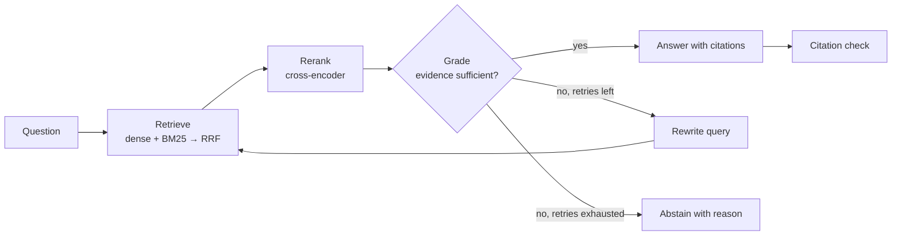
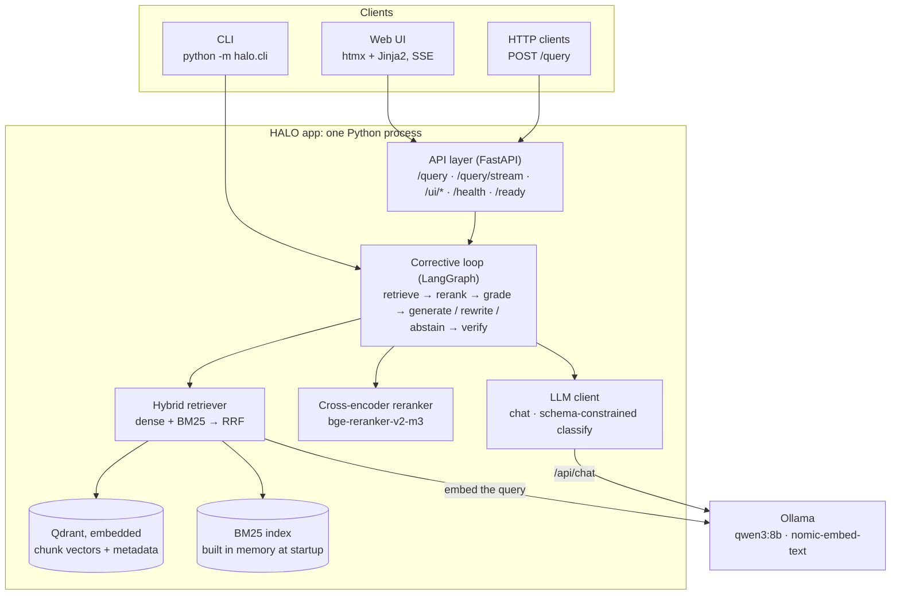
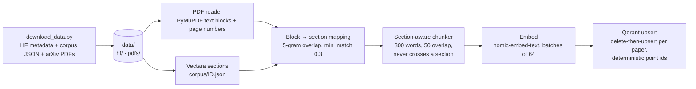
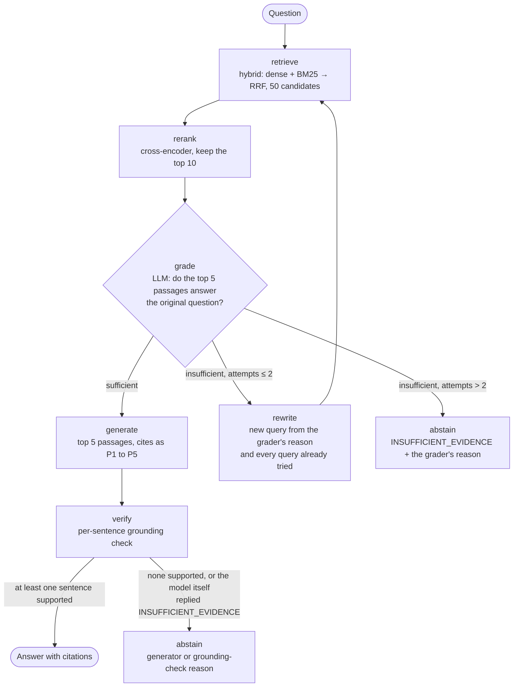
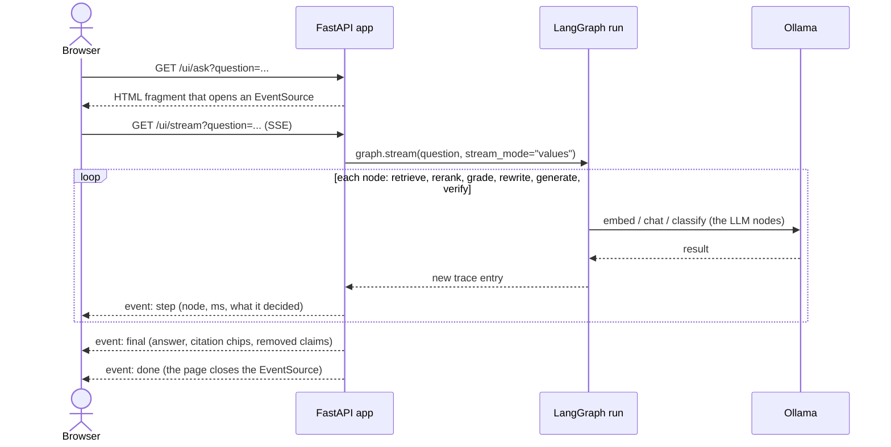
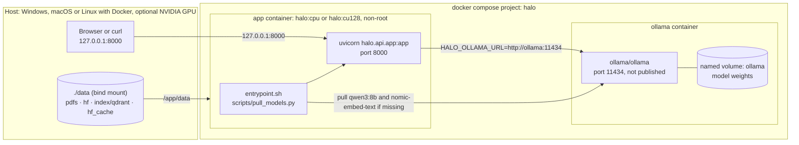
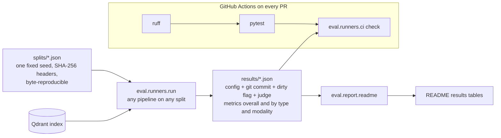
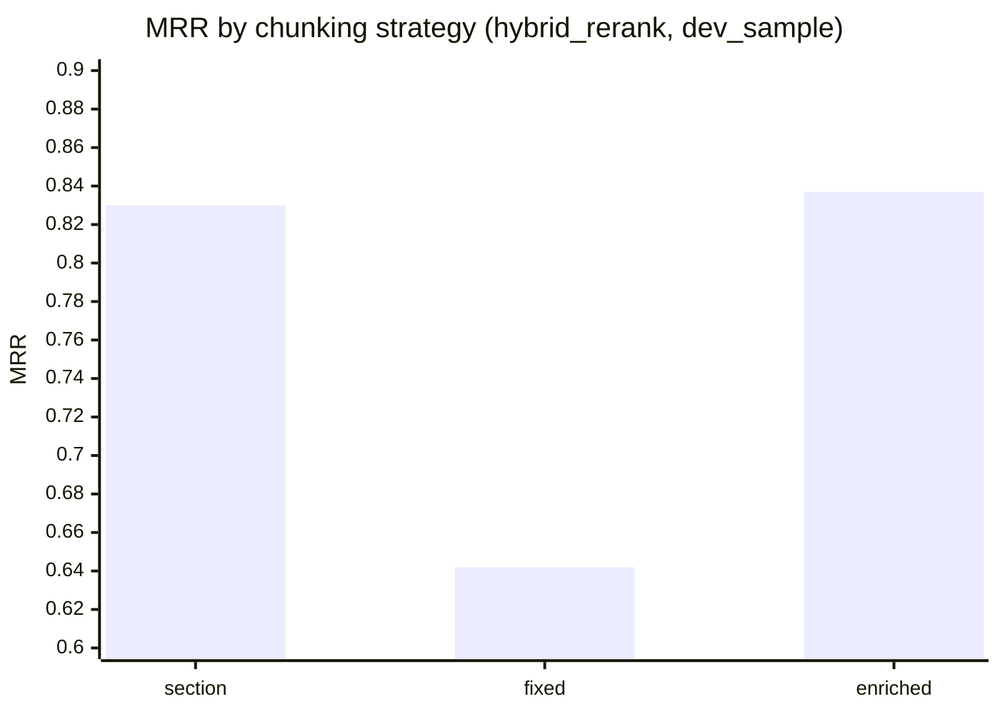

# HALO — Grounded Knowledge Engine

[](https://github.com/lunatictiol/halo/actions/workflows/ci.yml)

HALO answers questions over a hard corpus of 1,000 arXiv research papers. It **only answers when the papers support the answer**, cites where each claim comes from (paper, section, page), and **abstains** when the corpus can't back an answer up. It retrieves with hybrid search, reranks, checks whether the evidence actually answers the question, rewrites the query and retries when it doesn't, and verifies its own citations before it speaks.

It is also an evaluation project. Every stage was added only after a harness measured a before/after on a fixed question set, and every number below traces to a file in [`results/`](results/).

> **Every number in this README comes from a file in [`results/`](results/)**: the tables in [Results](#results) are generated by `uv run python -m eval.report.readme`, and the analysis quotes [`results/m6_report.md`](results/m6_report.md), [`results/m9_chunking.md`](results/m9_chunking.md), [`results/m10_stream_latency.json`](results/m10_stream_latency.json) and [`results/m11_docker.json`](results/m11_docker.json). Nothing is quoted from memory.

## Contents

1. [What it does](#what-it-does)
2. [At a glance](#at-a-glance)
3. [Architecture](#architecture) — system, indexing, the corrective loop, retrieval, citations, serving, Docker, evaluation
4. [Benchmark and data splits](#benchmark-and-data-splits)
5. [Stack](#stack)
6. [Quickstart](#quickstart) — Docker, local (uv), asking questions, configuration, troubleshooting
7. [Results](#results) — progression, scaling, chunking, streaming, Docker
8. [Known limitations](#known-limitations)
9. [Repository layout](#repository-layout)
10. [How it was built: milestones](#how-it-was-built-milestones)
11. [Backlog](#backlog)

## What it does

Given a question, HALO:

1. **Retrieves** candidate passages with hybrid search: dense embeddings and BM25 keyword search, fused with Reciprocal Rank Fusion.
2. **Reranks** the candidates with a cross-encoder.
3. **Grades** whether the evidence actually answers the question.
4. **Corrects itself**: if the evidence is insufficient, it rewrites the query and retrieves again (at most 2 retries).
5. **Answers with citations** (paper, section, page), or **abstains** with a reason when the evidence never becomes sufficient.
6. **Verifies** that every cited passage supports the sentence that cites it, and drops the sentences that fail.



Most RAG demos show that retrieval *works*. HALO is built to show that it is *measured*: the evaluation harness came before any optimization, and each stage (baseline → hybrid → rerank → corrective loop → grounded citations) had to show a measured improvement on the same fixed question set. Abstention is a first-class behavior, tested on questions whose source papers are deliberately never indexed.

## At a glance

| | |
|---|---|
| Corpus | 1,000 arXiv papers; 980 indexed (20 held out for the abstention test), 60,153 chunks ([`m6_index.txt`](results/m6_index.txt)) |
| Questions | 3,045 Open RAG Bench questions; **2,891 answerable** (`full`), 152 unanswerable by construction (`abstention_set`) |
| Answer quality, full corpus | **0.841 Correct** on all 2,891 answerable questions, **0.907** on the text-only ones (the MVP parses text only) ([`m6_graph_full.json`](results/m6_graph_full.json)) |
| Retrieval, full corpus | **R@5 0.917** against a single gold section per question |
| Abstention | **0.776** of the 152 unanswerable questions correctly refused on the full index (0.862 on the 100-paper dev index) |
| Progression on the dev sample | Correct 0.848 (dense baseline) → 0.901 (hybrid + rerank + loop + citations); R@5 0.868 → 0.937 |
| Honest caveats | Judge and generator are the same 8B model (κ 0.48 / 0.56 against my labels); citation validity is self-checked and overstated; see [Known limitations](#known-limitations) |
| Runs on | a 6 GB laptop GPU (`qwen3:8b` at Q4) or, in Docker, CPU-only or NVIDIA GPU |
| Engineering | 129 pytest tests, ruff, and a CI regression gate on retrieval metrics (D40) |

Correct = LLM-judged correct against the reference answer, where a refusal counts as wrong. The full definitions, the per-modality breakdown and the progression table are in [Results](#results).

## Architecture

The interactive version of the first diagram below (clients, the corrective loop, the retriever, the stores, the offline indexing pipeline) is [`docs/architecture/halo-architecture.html`](docs/architecture/halo-architecture.html): open it in a browser (GitHub shows the file as source, not rendered). The diagrams in this section are Mermaid and render on GitHub.

### System overview

HALO is one Python process (FastAPI + a LangGraph state graph) that owns two local stores, an embedded Qdrant index and an in-memory BM25 index, and talks to one external service, Ollama, for every language-model call.



| Component | Where | Responsibility |
|---|---|---|
| API layer | [`halo/api/app.py`](halo/api/app.py) | JSON endpoints, startup (builds the pipeline, refuses to start without an index), one-query-at-a-time lock |
| Web UI and SSE | [`halo/api/ui.py`](halo/api/ui.py), [`stream.py`](halo/api/stream.py), `templates/`, `static/` | Streams the graph's trace as events; renders them as HTML fragments |
| Corrective loop | [`halo/graph/pipeline.py`](halo/graph/pipeline.py) | The LangGraph state graph and its seven nodes |
| Retriever | [`halo/retrieve/`](halo/retrieve/) | Dense search, BM25, RRF fusion, reranking |
| Generation and citations | [`halo/generate/`](halo/generate/) | Prompted answer, `[Pn]` label → (paper, section, page) mapping, grounding check |
| LLM client | [`halo/llm.py`](halo/llm.py) | Ollama chat, JSON-schema-constrained classification, retries, context-limit guard |
| Ingestion | [`halo/ingest/`](halo/ingest/) | PDF text blocks, section mapping, chunking, embedding, indexing |
| Readiness | [`halo/api/ready.py`](halo/api/ready.py) | Index present at startup; Ollama serving both models on every `/ready` call |

### Offline indexing

Indexing runs once (`scripts/download_data.py`, then `scripts/ingest.py`) and writes everything the app needs into `data/`.



- **Why map blocks to sections instead of detecting headings.** The relevance labels (qrels) point at Vectara's own section IDs, which do not follow the PDF's headings. Each PDF text block takes the section that contains most of its word 5-grams; a block that matches no section well (headers, references, math-only blocks; below `min_match = 0.3`) inherits the previous block's section (D12, D13).
- **Chunks never cross a section.** A chunk is a 300-word window (50-word overlap) over consecutive blocks of one section, so a hit is attributable to exactly one (paper, section) pair, the unit the labels score (D14). Fixed-size windows that ignore sections lost 0.18 R@5 in the M9 benchmark ([below](#chunking-benchmark-m9)).
- **Every chunk carries its provenance:** `paper_id`, `chunk_idx`, `section_id`, `section_title`, `page`, `page_end` and `text`. All 60,153 chunks of the full index have a paper ID, section ID and page ([`m6_index.txt`](results/m6_index.txt)); this is what makes a citation resolvable.
- **Idempotent.** Point IDs are deterministic (`uuid5` of paper and chunk index) and each paper is deleted then re-upserted, so re-running ingestion leaves the same chunk count, no duplicates and no stale points from a changed chunker.
- **BM25 is not stored.** It is rebuilt in memory from the Qdrant payloads when the app starts, so it can never drift from the dense index (D21).
- Embeddings use nomic-embed-text's task prefixes (`search_document: ` for chunks, `search_query: ` for queries); omitting them degrades retrieval (D15).
- An optional contextual-enrichment step (an LLM writes 1–2 lines situating each chunk) exists and was measured; it is **not** used in the shipped index (D42, [below](#chunking-benchmark-m9)).

### The corrective loop

The query pipeline is an explicit LangGraph state graph, so every retry and abstention is a visible edge, not a hidden `while` loop.



| Node | What it does |
|---|---|
| `retrieve` | Runs the configured first-stage method (`hybrid`) on the *current* query, records it in `tried`, increments `attempts` |
| `rerank` | Scores the fused candidates against the current query with the cross-encoder, keeps the top `k_eval = 10` |
| `grade` | Asks `qwen3:8b` (JSON schema `{reason, verdict}`) whether the top `k_context = 5` passages are enough to answer the **original** question. A parse failure counts as "insufficient" (D27, D30) |
| `rewrite` | One-line replacement query written from the grader's reason and all earlier queries, so it does not repeat itself (D28) |
| `generate` | Answers from the top 5 passages with `[P1]`…`[P5]` labels, or replies `INSUFFICIENT_EVIDENCE` |
| `verify` | Splits the answer into sentences and checks each against its cited passages (next section) |
| `abstain` | Returns `INSUFFICIENT_EVIDENCE: <reason>` where the reason is the grader's own explanation of what is missing |

Rules that are easy to get wrong, and where they live:

- **The retry limit is enforced in exactly one place**, `route_after_grade`: `attempts ≤ max_retries` rewrites, otherwise abstains. With `max_retries = 2` a question gets at most three retrievals. A run across the full dev sample logged no query above that limit (M4 gate).
- **The grader and the generator always see the user's original question.** Only retrieval and reranking use the rewritten query, so a rewrite can widen the search but cannot change what is being asked.
- **Every node appends one entry to `trace`** (`node`, `ms`, and what it decided). That list is the per-query log in the results files, and it is exactly what the web UI streams.

A question's trace, with the number of steps measured on the full index ([`m10_stream_latency.json`](results/m10_stream_latency.json)):

| Case | Trace | Steps |
|---|---|---|
| answered first try | retrieve → rerank → grade → generate → verify | 5 |
| rescued by a rewrite | retrieve → rerank → grade → rewrite → retrieve → rerank → grade → generate → verify | 9 |
| abstained after 2 retries | (retrieve → rerank → grade → rewrite) ×2, then retrieve → rerank → grade → abstain | 12 |

### Retrieval

| Stage | Detail | Decision |
|---|---|---|
| Dense | Qdrant, cosine, `nomic-embed-text`, top 50 | D15 |
| Sparse | `bm25s` (k1 1.5, b 0.75, English stemming and stopwords), top 50 | D21 |
| Fusion | Reciprocal Rank Fusion, `score(d) = Σ 1 / (60 + rank(d))` over both rankings; ties break on `(paper_id, chunk_idx)` so the order is deterministic | D22 |
| Rerank | `BAAI/bge-reranker-v2-m3`, fp16 on CUDA, `max_length` 512, batch 16, over the fused 50; the top 10 are scored, the generator sees the top 5 | D23 |

RRF is rank-based, so dense cosine scores and BM25 scores never need to be put on a common scale, and one retriever cannot dominate. On the same 303 questions, hybrid retrieval lifts R@5 from 0.868 (dense) to 0.908 and the cross-encoder to 0.944; the full ablation, with per-query latency, is in [`results/m3_ablation.md`](results/m3_ablation.md) (D24). The reranker is the slowest stage on a CPU (39.7 s against 1.4 s per query on the GPU, D29), which is why the Docker CPU image works but is not the recommended way to run it.

### Generation, citations and the grounding check

- **The model cites labels; code resolves them.** The generator sees passages as `[P1]`…`[P5]` and ends each sentence with the label of the passage that supports it. Code, not the model, turns a label into `(paper, section, page)` from the chunk's stored metadata, so a citation can only point at a passage that was actually retrieved. Labels are `P`-prefixed because the papers' own bibliography markers (`[21]`) collided with plain numbers (D31, D34).
- **The grounding check is joint, per sentence.** For each sentence, one LLM call asks whether its cited passages *together* support everything it says (per-passage checks let one passage carry a second, unsupported claim). A sentence that passes keeps its citations. A sentence that fails, or has no citation, is tried against each other retrieved passage alone and re-attributed to the first that supports it; otherwise it is **removed**. If no sentence survives, the answer becomes an abstention (D32, D35).
- **Output form:** `... Adam with a learning rate of 3e-4 [2406.01234v2 §4 p.6].` and, in the JSON response, a deduplicated `citations` list of paper, section, section title and page.
- **What this does and does not prove.** The citation-validity figure in the results is the pipeline's own check (0.97+). When I read 10 cited answers by hand, 7 had valid citations, so it is an upper bound (D35, [Known limitations](#known-limitations)).

### Serving: HTTP API, SSE and the web UI

| Route | Purpose |
|---|---|
| `GET /health` | Liveness: the process is up (answers even while Ollama is down) |
| `GET /ready` | Readiness: `200 {"status": "ready"}`, or `503` with the reasons (Ollama unreachable, a model not pulled). The index is checked once at startup: the app refuses to start without it and prints how to build it |
| `POST /query` | One question → one JSON answer (`answer`, `abstained`, `abstain_reason`, `citations`, `retries`). Queued behind a running query |
| `POST /query/stream` | The same pipeline as Server-Sent Events: `step` events (one per graph node), then `final` (the answer plus `total_ms` and the sentences the grounding check removed) or `error`. `429` if busy |
| `GET /` | The web UI |
| `GET /ui/ask`, `GET /ui/stream` | The UI's two GET routes (the htmx SSE extension can only open `GET` event streams); `/ui/stream` renders each event as an HTML fragment and always ends with `done` |
| `/static/*` | Vendored htmx, its SSE extension, KaTeX and CSS: no CDN, no npm, no build step |



- **One query at a time (D37).** One GPU serves both the LLM and the reranker, and embedded Qdrant is single-process, so concurrency would only queue on the GPU. A second `/query/stream` or UI request gets a clear *busy* response; `/query` waits for the lock.
- **The UI streams the real trace.** The corrective loop (including rewrites and retries), citation chips linking to the arXiv PDF at the cited page, abstention reasons, and struck-through removed claims are rendered from the same events as the API (D43). LaTeX in answers is typeset with vendored KaTeX.
- **`GET /ui/stream` starts a GPU run**, so `/ui/*` rejects `Sec-Fetch-Site: cross-site` requests: another web page cannot trigger a run in your browser. There is no authentication, which is why the Docker port is bound to loopback.

### Deployment: Docker

The Docker setup (M11) is two containers, one volume and one bind mount. The image contains the code and the Python environment only; the corpus, the index and the model weights never enter an image layer.



- **Two image variants from one Dockerfile.** `halo:cpu` (default) and `halo:cu128` (`--build-arg TORCH=cu128`, selected by `docker-compose.gpu.yml`). `uv.lock` already resolves Linux to CPU wheels; the GPU variant reinstalls `torch` from the CUDA 12.8 index. The GPU override also reserves the NVIDIA device for Ollama and the app.
- **Start-up order is enforced.** `app` waits for Ollama's healthcheck; its entrypoint then pulls any missing Ollama model and the reranker's weights (so the first *query* never stalls on a download), skipping anything already present, so a restart works offline; then `uvicorn` starts and refuses to come up if the index collection is missing. The compose healthcheck polls `/ready`.
- **Configuration by environment, not by editing TOML.** `HALO_OLLAMA_URL`, `HALO_RERANK_DEVICE` (`auto` in the image: GPU when present) and `HALO_COLLECTION` override three config values; every other tunable stays in [`config/default.toml`](config/default.toml), so results files keep describing the pipeline (D44).
- **Loopback only.** Port 8000 is published on `127.0.0.1`, Ollama's port is not published at all (so it cannot clash with a host Ollama), and the app runs as a non-root user.

### Evaluation harness and CI



- **Splits are fixed and never re-rolled.** `held_out` (20 source papers, never indexed), `abstention_set` (all 152 questions of those papers; the correct behavior is to abstain), `dev_slice` (~100 papers for iteration), `dev_sample` (303 questions, selected at paper level) and `full` (2,891 answerable questions, run only at milestone completion). One seed, committed files, SHA-256 of the sources in each header, regenerated byte-identically (D4–D9).
- **Metrics.** Retrieval: R@5, R@10, MRR and nDCG@10 against the single gold section per question (with one relevant section, R@k is hit@k and MRR is the most informative number). Answer: Correct (LLM judge against the reference) and Faithful (is the answer supported by its context). Abstention: the share of `abstention_set` refused, and the false-abstention rate on answerable questions. Citations: validity and coverage. Everything is reported overall and by question type and modality, never by the 8-cell cross (cells too small). Definitions: D16, D17.
- **Every run writes one results JSON** with the full config snapshot, the git commit and whether the tree was dirty, the judge model, timestamps and per-query records. The README tables are generated from those files, so a number cannot be edited into the README by hand.
- **The judge was calibrated.** 50 blind human labels against two judges, Cohen's κ per verdict kind (M7, D39); the result and its direction of bias are in [Known limitations](#known-limitations).
- **CI regression gate (M8, D40).** On a hosted runner there is no index and no Ollama, so CI does not re-run retrieval. It checks a committed results file instead (`results/ci_retrieval_dev_sample.json`, produced locally by `eval.runners.ci run`): the file fails the gate if it was made from a dirty tree, from a commit that is not an ancestor of `HEAD`, or before a watched path (`halo/`, `config/`, `splits/`, `eval/`, `pyproject.toml`, `uv.lock`) changed; if its summary does not match its per-query records; or if R@5 or MRR dropped more than 0.005 below the committed baseline. A deliberately degraded config (reranking off) failed the gate on a real PR ([`results/m8_gate.md`](results/m8_gate.md)).

### Design invariants

- Evaluation before optimization: a feature without a measured before/after is not done, and every README number comes from `results/`.
- The retry limit lives in one function; the grader and generator always see the original question.
- Citations are resolved from stored chunk metadata by code, never from model text.
- Deterministic where it can be: temperature 0 and a fixed seed for the LLM, a deterministic RRF tie-break, byte-reproducible splits, idempotent ingestion.
- Config over code: every tunable (k values, RRF constant, retry limit, model names, prompts and their versions, thresholds) is in [`config/default.toml`](config/default.toml). Environment variables only carry facts that differ per deployment.
- Every non-obvious choice has an entry in [`DECISIONS.md`](DECISIONS.md) (D1–D44) with the alternatives and the metric that justified it.

## Benchmark and data splits

[Vectara Open RAG Bench](https://huggingface.co/datasets/vectara/open_ragbench) ([GitHub](https://github.com/vectara/open-rag-bench)), arXiv subset, official release:

- 1,000 papers: 396 papers with questions + 604 distractors
- 3,045 questions, labeled extractive/abstractive and by modality (text, text+image, text+table, text+table+image)
- Section-level relevance labels: exactly one relevant section per question

The MVP parses text only, so **text-modality questions are the primary metric**; image/table questions are still evaluated and reported separately so the gap is visible. Dataset formats as actually inspected are documented in [`DATA.md`](DATA.md); design choices and their justifying numbers in [`DECISIONS.md`](DECISIONS.md).

| Split | Contents | Used for |
|---|---|---|
| `held_out` | 20 source papers, never indexed at any scale | defines the abstention test |
| `abstention_set` | all 152 questions of the held-out papers | abstention rate (correct behavior: refuse) |
| `dev_slice` | ~100 papers: 40 source papers + 60 distractors from the same arXiv categories | every iteration, M1–M5 |
| `dev_sample` | 303 questions of the 40 dev source papers | tuning and the progression table |
| `full` | 2,891 answerable questions | milestone completion runs only |

## Stack

| Layer | Choice |
|---|---|
| Language, packaging | Python 3.12, [uv](https://docs.astral.sh/uv/) |
| Orchestration | LangGraph (the corrective loop as an explicit state graph) |
| Generation, grading, rewriting, citation check | Ollama, `qwen3:8b`: the best model that fits a 6 GB RTX 4050 at Q4 (D10); name is config, not code |
| Embeddings | `nomic-embed-text` via Ollama |
| Vector store | Qdrant, embedded (local) mode; no server |
| Sparse retrieval | `bm25s` |
| Reranker | `BAAI/bge-reranker-v2-m3` cross-encoder via sentence-transformers |
| PDF parsing | PyMuPDF, text only |
| Serving | FastAPI, uvicorn, htmx + Jinja2, Server-Sent Events |
| Packaging for deployment | Docker, Docker Compose (CPU and CUDA variants) |
| Quality | pytest, ruff, GitHub Actions |

Fully local: nothing leaves the machine except the one-time downloads (arXiv, Hugging Face, Ollama's model registry).

## Quickstart

### Docker (recommended)

Needs [Docker](https://docs.docker.com/get-docker/) with Compose v2. For the GPU variant: an NVIDIA GPU and either Docker Desktop with WSL2 or the NVIDIA Container Toolkit. Disk, as measured on the machine in [Docker results](#docker-deployment-m11): the `ollama/ollama` image is 8.5 GB and its models another ~5.5 GB, the PDFs and index in `data/` ~6 GB, and the HALO image 2.2 GB (CPU) or 8.7 GB (CUDA).

```bash
git clone https://github.com/lunatictiol/halo && cd halo

# 1. Build the image once.
docker compose build                                                      # CPU variant
docker compose -f docker-compose.yml -f docker-compose.gpu.yml build      # NVIDIA GPU variant

# 2. Build the index, once (the first command also pulls the models, see below).
docker compose run --rm app python scripts/download_data.py        # HF metadata + corpus + 1,000 arXiv PDFs (~1 h, resumable)
docker compose run --rm app python scripts/ingest.py --split full  # chunk + embed the 980 indexable papers (~1-2 h on a GPU)

# 3. Serve.
docker compose up -d                                               # web UI at http://127.0.0.1:8000/
```

With the GPU variant, pass the same `-f docker-compose.yml -f docker-compose.gpu.yml` to every `docker compose` command (or export Compose's `COMPOSE_FILE` variable). Plain commands use the CPU image, which works but reranks ~30× slower.

What happens on first start:

- The `ollama` container starts and passes its healthcheck; the `app` entrypoint then pulls `qwen3:8b` (~5.2 GB) and `nomic-embed-text` (~0.3 GB) into the `ollama` volume, and the reranker's weights (~2 GB) into `data/hf_cache`. Later starts skip all of it, offline.
- If you run `up` without an index, the app exits immediately with `index collection 'full' not found: build it first` instead of failing on the first question.
- `docker compose ps` shows `app` as *healthy* once `/ready` answers; `curl http://127.0.0.1:8000/ready` shows why if it does not.

Day-to-day:

```bash
docker compose logs -f app          # follow the pipeline
docker compose stop app             # REQUIRED before re-ingesting: embedded Qdrant allows one process
docker compose down                 # stop everything; models and index are kept
docker compose down -v              # also delete the Ollama model volume (it will be re-pulled)
```

Faster try-out on the ~100-paper dev slice (still needs `download_data.py` to finish, which fetches all PDFs):

```bash
docker compose run --rm app python scripts/ingest.py --split dev_slice
HALO_COLLECTION=dev_slice docker compose up -d
```

Keep the data somewhere else with `HALO_DATA=/path/to/data docker compose ...`. On a Linux host, `./data` must be writable by the container user (uid 1000 by default); otherwise set `HALO_UID` and `HALO_GID` to its owner.

### Local (uv)

Needs [uv](https://docs.astral.sh/uv/) and [Ollama](https://ollama.com/). A CUDA GPU is optional: on a CPU-only machine set `[rerank] device = "auto"` in `config/default.toml` (or `HALO_RERANK_DEVICE=auto`); reranking is ~30× slower on CPU.

```bash
git clone https://github.com/lunatictiol/halo && cd halo
uv sync
ollama pull qwen3:8b && ollama pull nomic-embed-text

uv run python scripts/download_data.py          # HF metadata + parsed corpus + 1,000 arXiv PDFs (~1 h, resumable)
uv run python scripts/ingest.py --split full    # chunk + embed the 980 indexable papers into embedded Qdrant (~1-2 h)

uv run python -m halo.cli "What datasets are used to evaluate the proposed method?"
uv run uvicorn halo.api.app:app                 # web UI at http://127.0.0.1:8000/, POST /query, POST /query/stream, GET /health, GET /ready
```

For a faster try-out, `scripts/ingest.py --split dev_slice` indexes the ~100-paper dev slice and `python -m halo.cli --collection dev_slice "..."` queries it (`HALO_COLLECTION=dev_slice` serves it from the API).

### Asking questions

```bash
# Web UI
open http://127.0.0.1:8000/

# JSON API
curl -s http://127.0.0.1:8000/query -H 'content-type: application/json' \
     -d '{"question": "What optimizer does the paper use?"}'

# Streaming: one `step` event per graph node, then `final`
curl -N http://127.0.0.1:8000/query/stream -H 'content-type: application/json' \
     -d '{"question": "What optimizer does the paper use?"}'

# Inside the Docker stack, without the server
docker compose run --rm app python -m halo.cli "What optimizer does the paper use?"
```

`POST /query` returns:

```json
{"answer": "... [2406.01234v2 §4 p.6].", "abstained": false, "abstain_reason": null,
 "citations": [{"paper_id": "2406.01234v2", "section_id": 4, "section_title": "Experiments", "page": 6}],
 "retries": 0}
```

An abstention has `"abstained": true`, an answer that starts with `INSUFFICIENT_EVIDENCE:` and an `abstain_reason`. A question must be non-empty and at most 1,000 characters (the longest benchmark question is 197).

### Configuration

All tunables live in [`config/default.toml`](config/default.toml); `DECISIONS.md` says why each value was chosen. The sections that matter most:

| Section | Controls | Shipped values |
|---|---|---|
| `[models]` | LLM, embedding model, Ollama URL | `qwen3:8b`, `nomic-embed-text`, `http://127.0.0.1:11434` |
| `[ingest]` | chunking | 300-word windows, 50 overlap, 5-gram mapping, `min_match` 0.3 |
| `[retrieve]` | what to search and how | collection `full`, `hybrid_rerank`, 50 candidates, RRF constant 60, top 10 scored, top 5 to the generator |
| `[rerank]` | cross-encoder | `BAAI/bge-reranker-v2-m3`, `max_length` 512, device `cuda` |
| `[llm]` | decoding | temperature 0, seed 0, `num_ctx` 8192, thinking off, `num_gpu` 22 (of 36 layers, for 6 GB; D29) |
| `[graph]` | the loop | `max_retries` 2, grader and rewriter prompts and their versions |
| `[cite]` | citations | prompt `cite-v2`, grounding check `check-v2` |
| `[api]` | serving | 1,000-character questions, 3 s Ollama probe timeout |
| `[ci]` | regression gate | R@5 and MRR on `dev_sample`, max drop 0.005 |

Environment variables (deployment facts only):

| Variable | Effect | Default |
|---|---|---|
| `HALO_OLLAMA_URL` | overrides `[models] ollama_url` | set to `http://ollama:11434` by `docker-compose.yml` |
| `HALO_RERANK_DEVICE` | overrides `[rerank] device` | `auto` in the Docker image |
| `HALO_COLLECTION` | overrides `[retrieve] collection` | unset (`full`) |
| `HALO_DATA`, `HALO_UID`, `HALO_GID` | compose only: data directory and its owner | `./data`, 1000, 1000 |
| `GEMINI_API_KEY` | only for the optional hosted judge in evaluation; read from the environment or a gitignored `.env`, never baked into an image | unset |

### Troubleshooting

| Symptom | Cause and fix |
|---|---|
| App exits with `index collection 'full' not found` | The index step has not run, or you ingested another split: run `ingest.py --split full`, or serve the one you built with `HALO_COLLECTION` |
| `/ready` returns 503 `ollama unreachable` or `model ... not pulled` | First start is still pulling; watch `docker compose logs -f app` and `docker compose logs ollama` |
| `429 busy` / "Busy" in the UI | One query at a time by design (D37); retry when the running one finishes |
| Every query takes minutes | Probably the CPU image on a machine with a GPU: use the GPU variant, or the CPU reranker costs ~40 s per query |
| Out of GPU memory | `[llm] num_gpu = 22` is tuned for 6 GB; lower it on smaller GPUs, raise it on larger ones |
| `PermissionError` under `./data` (Linux) | The container user cannot write the bind mount: set `HALO_UID` and `HALO_GID` to the owner of `./data` |
| `database is locked` / Qdrant lock error during ingest | `app` is still running: `docker compose stop app` first |
| Port 11434 already used | Not a Docker problem: the compose Ollama publishes no port, so a host Ollama does not clash |

### Reproducing the evaluation

```bash
uv run pytest
uv run python -m eval.runners.run --split dev_sample --pipeline graph --name m6_graph   # also: abstention_set, full
uv run python -m eval.report.readme                                                      # regenerate the tables below
uv run python -m eval.runners.ci check                                                   # the CI gate, locally (git + results file only)
```

Runs checkpoint per question under `data/runs/` and resume after an interruption. M1-M5 results were measured on the ~100-paper dev index; add `--collection dev_slice` to reproduce them.

## Results

<!-- results:start -->

<!-- Generated by `uv run python -m eval.report.readme`; do not edit by hand. -->

### Progression on `dev_sample` (303 answerable questions)

| Stage | Change | Run | R@5 | MRR | Correct | Correct (text) | Faithful | False-abst | Abstention ↑ | Cite valid | Median s/q |
|---|---|---|---|---|---|---|---|---|---|---|---|
| M2 baseline | dense top-5 → answer | [`m2_baseline`](results/m2_baseline_dev_sample.json) | 0.868 | 0.707 | 0.848 | 0.868 | 0.975 | 0.063 | 0.875 | – | 11.4 |
| M3 hybrid | + BM25, RRF fusion (retrieval only) | [`m3_retrieval_hybrid`](results/m3_retrieval_hybrid_dev_sample.json) | 0.908 | 0.759 | – | – | – | – | – | – | – |
| M3 rerank | + cross-encoder rerank | [`m3_hybrid_rerank`](results/m3_hybrid_rerank_dev_sample.json) | 0.944 | 0.830 | 0.908 | 0.951 | 0.987 | 0.020 | 0.809 | – | 14.6 |
| M4 loop | + grade → rewrite → retry, abstain | [`m4_graph_v2`](results/m4_graph_v2_dev_sample.json) | 0.937 | 0.820 | 0.908 | 0.946 | 0.986 | 0.033 | 0.882 | – | 16.2 |
| M5 grounded | + citations, grounding check | [`m5_check_v2`](results/m5_check_v2_dev_sample.json) | 0.937 | 0.820 | 0.901 | 0.941 | 0.986 | 0.040 | 0.862 | 0.976 | 26.7 |
| M6 full corpus | same pipeline, 980-paper index | [`m6_graph`](results/m6_graph_dev_sample.json) | 0.927 | 0.806 | 0.898 | 0.931 | 0.990 | 0.043 | 0.776 | 0.974 | 25.8 |

Correct = LLM-judged correct vs the reference (a refusal counts as wrong). Faithful = answered questions judged supported by the retrieved context. False-abst = answerable questions refused. Abstention ↑ = share of `abstention_set` (152 questions whose papers are never indexed) correctly refused. Cite valid = generator citations whose passages support their sentence. R@5 and MRR are against the single gold section, on the top-5 the answer was generated from. Judge and generator are both `qwen3:8b`.

### Scaling to the full corpus

| Slice | n dev_sample | n full | Dev index, dev_sample: R@5 | Dev index, dev_sample: Correct | Full index, dev_sample: R@5 | Full index, dev_sample: Correct | Full index, full: R@5 | Full index, full: Correct |
|---|---|---|---|---|---|---|---|---|
| overall | 303 | 2891 | 0.937 | 0.901 | 0.927 | 0.898 | 0.917 | 0.841 |
| type: extractive | 124 | 1198 | 0.968 | 0.887 | 0.952 | 0.887 | 0.938 | 0.864 |
| type: abstractive | 179 | 1693 | 0.916 | 0.911 | 0.911 | 0.905 | 0.901 | 0.825 |
| modality: text | 204 | 1801 | 0.961 | 0.941 | 0.951 | 0.931 | 0.945 | 0.907 |
| modality: text-image | 72 | 736 | 0.875 | 0.806 | 0.861 | 0.819 | 0.847 | 0.709 |
| modality: text-table | 13 | 143 | 0.923 | 0.769 | 0.923 | 0.769 | 0.938 | 0.769 |
| modality: text-table-image | 14 | 211 | 0.929 | 0.929 | 0.929 | 0.929 | 0.905 | 0.791 |

Abstention rate on `abstention_set`: dev index 0.862, full index 0.776. Sources: [`m5_check_v2_*`](results/), [`m6_graph_*`](results/).

### Examples

<details><summary>Rewrite loop rescued a failed first retrieval (7 on <code>dev_sample</code>, 5 shown, from <code>m4_graph_v2</code>)</summary>

### `3738d2b7-fe0b-412a-bdf7-c88a0f0e4aee` (abstractive, text-image)

- **Question:** How are filamentary coils approximated in discrete optimization?
- **Attempt 1 grade:** insufficient: The passages discuss the approximation of filamentary coils using wireframe segments and mention that space curves are approximated as polygons, but they do not explicitly explain how filamentary coils are approximated in discrete optimization.
- **Rewrite 1:** `How are filamentary coils modeled as polygonal chains in discrete optimization algorithms?`
- **Gold in top-5:** first attempt yes, final no (MRR 1.00 → 0.12)
- **Answer:** Filamentary coils are approximated in discrete optimization by using wireframe current paths that consist of interconnected wire segments. These paths, while containing sharp, angular turns, serve as a starting point for more realistic coil designs and can be refined using optimization techniques such as FOCUS, DESC, GOSPEL, or SIMSOPT.
- **Reference:** Filamentary coils are often approximated as polygons, where space curves are represented by straight wire segments. This simplification allows for easier calculation of magnetic fields using methods like the Biot-Savart law.

### `6a149c18-c83d-4faa-8210-bbd6e598216b` (abstractive, text-image)

- **Question:** How does graph Laplacian coupling contribute to understanding pattern formations?
- **Attempt 1 grade:** insufficient: The passages discuss graph Laplacian coupling in the context of pattern formation and its role in modeling spatial dynamics, but they do not explicitly explain how graph Laplacian coupling contributes to understanding pattern formations.
- **Rewrite 1:** `What is the mechanism by which graph Laplacian coupling facilitates the analysis of pattern formation in spatially extended systems?`
- **Gold in top-5:** first attempt yes, final yes (MRR 1.00 → 1.00)
- **Answer:** Graph Laplacian coupling contributes to understanding pattern formation by enabling the study of spatial dynamics in discrete models, where it replaces diffusion and allows for the emergence of spatially periodic patterns, similar to those observed in continuous reaction-diffusion systems. This coupling facilitates the analysis of stability and bifurcations, providing insights into the conditions under which patterns can form.
- **Reference:** Graph Laplacian coupling helps model spatial relationships and connectivity between elements within a system. It aids in understanding how local and global interactions contribute to emergent patterns like those observed in animal skin or plant structures.

### `83dda238-c421-4f22-aec5-7c6c83875eb3` (abstractive, text)

- **Question:** What does it mean for an element to be in the lidentity of itself?
- **Attempt 1 grade:** insufficient: The passages discuss the concept of left identity and related sets in semigroup theory, but they do not directly address the meaning of an element being in the 'lidentity of itself'.
- **Rewrite 1:** `What is the definition of an element being in the left identity of itself in semigroup theory?`
- **Gold in top-5:** first attempt yes, final yes (MRR 0.33 → 0.50)
- **Answer:** For an element to be in the lidentity of itself, it means that the element is an idempotent. This is because an element $ e $ is in $ lidentity(e) $ if and only if $ e $ is an idempotent, i.e., $ ee = e $.
- **Reference:** An element \(e\) is in the lidentity of itself if and only if it is an idempotent.

### `86997f53-2801-4007-a0e4-de847455b000` (abstractive, text-table-image)

- **Question:** How does inheritance affect access to member variables in object-oriented programming?
- **Attempt 1 grade:** insufficient: The passages discuss inheritance and nested classes in object-oriented programming but do not directly explain how inheritance affects access to member variables.
- **Rewrite 1:** `How does inheritance influence access control and visibility of member variables in object-oriented programming languages?`
- **Gold in top-5:** first attempt yes, final yes (MRR 1.00 → 1.00)
- **Answer:** In object-oriented programming, inheritance allows derived classes to access members of the base class. Protected members of the base class are accessible to derived classes, while private members are not. Public members are accessible to all.
- **Reference:** Inheritance allows a derived class to inherit properties and behaviors from a base class. Member variables with protected access in the base class can be accessed directly by derived classes but remain inaccessible outside these classes unless accessed through public methods or functions provided by those classes.

### `c78b0dd7-2e8e-4f61-a9fb-4e49af5c9d80` (abstractive, text-image)

- **Question:** What role does wind direction play in sailboat maneuvering strategies?
- **Attempt 1 grade:** insufficient: The passages discuss how wind direction affects sailboat maneuvering by influencing tacking strategies and the boat's motion, but they do not explicitly state the role of wind direction in maneuvering strategies.
- **Rewrite 1:** `What is the impact of wind direction on tacking strategies and sailboat maneuvering efficiency?`
- **Gold in top-5:** first attempt yes, final yes (MRR 1.00 → 1.00)
- **Answer:** Wind direction plays a critical role in sailboat maneuvering strategies as it influences the boat's ability to tack or jibe, affecting the time required to reach the target. The paper assumes wind direction follows a Brownian motion, and the boat's reference frame is aligned with the wind direction to simplify the equations of motion and derive optimal strategies. Fluctuations in wind direction necessitate changes in the boat's heading, leading to tacking or jibing maneuvers that impact the overall travel time.
- **Reference:** Wind direction affects yacht velocity and dictates maneuvers like tacking and jibing, which are used to switch between starboard and port tack efficiently.

</details>

<details><summary>Correct abstentions on <code>abstention_set</code> (5 shown, from <code>m4_graph_v2</code>)</summary>

### `02ec0c1e-a71b-4536-abaa-73fbd56a541f` (grader abstained after 2 retries)

- **Question:** What happens when all consumers are allowed to migrate with respect to inter-regional trade integration?
- **Query 1:** `What happens when all consumers are allowed to migrate with respect to inter-regional trade integration?`
- **Query 2:** `What are the economic implications of free consumer migration on inter-regional trade integration and labor market dynamics?`
- **Query 3:** `What are the effects of full consumer migration freedom on inter-regional trade integration and labor market equilibrium?`
- **Response:** INSUFFICIENT_EVIDENCE: The passages discuss market integration, price contagion, and trade networks but do not specifically address the scenario where all consumers are allowed to migrate and its impact on inter-regional trade integration.

### `08c9a683-df57-4491-8056-5399b34a304d` (grader abstained after 2 retries)

- **Question:** Is the function for estimating causal effects dependent on both alpha and beta transposed with X?
- **Query 1:** `Is the function for estimating causal effects dependent on both alpha and beta transposed with X?`
- **Query 2:** `Is the function for estimating causal effects in linear regression dependent on the transposition of alpha and beta with the covariate matrix X?`
- **Query 3:** `Is the function for estimating causal effects in linear regression dependent on the transposition of the coefficient vectors alpha and beta with the covariate matrix X?`
- **Response:** INSUFFICIENT_EVIDENCE: The passages do not mention anything about the function for estimating causal effects depending on alpha and beta transposed with X.

### `0949e078-a396-4840-801b-b0bc8ef905d1` (grader abstained after 2 retries)

- **Question:** How do consumer preferences affect regional utility in economic models?
- **Query 1:** `How do consumer preferences affect regional utility in economic models?`
- **Query 2:** `How do consumer preference parameters influence regional utility functions in discrete choice economic models?`
- **Query 3:** `How do consumer preference heterogeneity and utility maximization principles influence regional utility aggregation in spatial economic models?`
- **Response:** INSUFFICIENT_EVIDENCE: The passages discuss consumer preferences and their influence on CSA participation in Japan, but they do not directly address how consumer preferences affect regional utility in economic models.

### `09a82aff-63f2-4955-99b2-5e0255226bba` (grader abstained after 2 retries)

- **Question:** At what collision energy does the cross-section stabilize around 100 Ų for all transitions?
- **Query 1:** `At what collision energy does the cross-section stabilize around 100 Ų for all transitions?`
- **Query 2:** `What collision energy corresponds to the stabilization of the cross-section at approximately 100 Ų across all transition channels?`
- **Query 3:** `What is the collision energy at which the cross-section stabilizes to approximately 100 Ų across all transition channels in ion-molecule reactions?`
- **Response:** INSUFFICIENT_EVIDENCE: The passages do not mention anything about collision energy or cross-section stabilization around 100 Ų.

### `0aa05517-ed7e-432f-b97c-162f97e7b803` (grader abstained after 2 retries)

- **Question:** What are typical latent dimensions used for different components in numerical experiments involving PDEs?
- **Query 1:** `What are typical latent dimensions used for different components in numerical experiments involving PDEs?`
- **Query 2:** `What are common latent space dimensions employed in different components of numerical methods for solving partial differential equations?`
- **Query 3:** `What are typical latent dimension sizes utilized in different components of neural operators for numerical solutions of partial differential equations?`
- **Response:** INSUFFICIENT_EVIDENCE: The passages discuss neural operators and their applications in solving PDEs and structural dynamics, but they do not mention latent dimensions used in numerical experiments involving PDEs.

</details>

<!-- results:end -->

### Why the full corpus scores lower

From [`results/m6_report.md`](results/m6_report.md), each comparison changes one thing at a time:

- **The bigger index costs little.** On the same 303 `dev_sample` questions, moving from the 100-paper dev index to the 980-paper index lowers R@5 from 0.937 to 0.927 and Correct from 0.901 to 0.898. Ten times more distractors barely hurt retrieval.
- **Most of the drop comes from the questions.** Inside the single full-index run, `dev_sample` questions score 0.894 Correct and the other 2,590 questions score 0.835. Retrieval is almost the same (R@5 0.927 vs 0.915), but those questions are answered less well when answered (0.934 vs 0.892), abstained on more often (0.043 vs 0.063), and include harder text-image questions (Correct 0.806 vs 0.699). Every prompt and threshold was tuned on `dev_sample`, so it is an optimistic estimate; **the `full` numbers are the honest ones.** Of the 427 wrong answers among the other questions, 216 had the gold section in the top-5 (a generation or judging miss), 164 were refusals, and only 47 were retrieval misses.
- **Abstention weakens as the corpus grows.** On the same 152 `abstention_set` questions, HALO answered 34 with the full index against 21 with the dev index. For 17 of the 34, the top passage came from an official distractor: more papers means more passages close enough to a question that the grader judges them sufficient (24 of the 34 were graded sufficient on the first attempt). Some of these may genuinely be answered by another paper; they were not hand-checked.

### Chunking benchmark (M9)

Three chunking strategies on the 100-paper dev index, same retrieval pipeline (`hybrid_rerank`), `dev_sample` (n = 303). From [`results/m9_chunking.md`](results/m9_chunking.md):

| Strategy | Chunks | R@5 | R@10 | MRR | nDCG@10 | Ingest cost |
|---|---|---|---|---|---|---|
| **Section-aware (shipped)**: 300-word windows that never cross a section | 6,740 | 0.944 | 0.970 | 0.830 | 0.865 | 3 min |
| Fixed-size: the same windows, ignoring sections | 5,406 | 0.766 | 0.815 | 0.642 | 0.684 | 2 min |
| Section-aware + contextual enrichment: 1–2 LLM lines situating each chunk in its paper | 6,740 | 0.941 | 0.980 | 0.837 | 0.872 | 188 min (3.2 GPU-h of `gemma3`) |



- **Section boundaries matter.** Fixed-size windows lose 0.18 R@5. Part of that is structural: 46 gold sections are too short to be the majority of any window, so they can never be hit. But on the 257 questions fixed-size *can* answer, it still trails (R@5 0.903 vs 0.957, MRR 0.757 vs 0.856).
- **Contextual enrichment is a tie, so it is not shipped.** It improves R@10 and MRR slightly but loses 0.003 R@5. Per question it moved the gold section up for 36 and down for 35. Those differences are within run-to-run noise (re-embedding the same chunks moved dense R@5 by 0.003). Rebuilding the full index would take about 29 GPU-hours. It was not run end-to-end, because retrieval showed no gain and most wrong answers are generation misses (D42).

### Streaming API and web UI (M10)

`POST /query/stream` runs the same pipeline as `/query` and streams it as Server-Sent Events: one `step` event per graph node (`retrieve`, `rerank`, `grade`, `rewrite`, `generate`, `verify`, `abstain`) with its time and what it decided, then a `final` event with the `/query` answer plus `total_ms` and the sentences the grounding check removed. A second request while one is running gets `429 busy`. The page at `/` (htmx + Jinja2, vendored, no build step) shows the same stream live: the corrective loop with its rewrites, citation chips linking to the arXiv PDF at the cited page, abstention reasons, and removed claims struck through.

| Screenshot | Question role | Result |
|---|---|---|
| [`docs/m10_direct.png`](docs/m10_direct.png) | answered first try | 0 retries, answer + 1 citation chip |
| [`docs/m10_rescued.png`](docs/m10_rescued.png) | rescued by a rewrite | 1 retry, answer + 2 citation chips |
| [`docs/m10_abstention.png`](docs/m10_abstention.png) | correct abstention | 2 retries, "No answer" with the grader's reason |

Latency over HTTP on the full index, after one warm-up query, one run per question ([`results/m10_stream_latency.json`](results/m10_stream_latency.json)):

| Question | Time to first event | Total | Steps |
|---|---|---|---|
| answered first try | 1,022 ms | 21.4 s | 5 |
| rescued by a rewrite | 1,475 ms | 40.5 s | 9 |
| abstention (2 retries) | 837 ms | 37.7 s | 12 |

The first event is the `retrieve` step finishing, so the user sees progress after 1-1.5 s instead of waiting 21-41 s for the answer. The server's own `total_ms` is within 0.06 s of the client's total, so HTTP and SSE framing add negligible overhead (`/query` itself was not re-timed). It is three runs, not a distribution: an earlier run of the same questions on the same code took 19.8, 36.3 and 34.8 s. A cold server (models not yet loaded) took about 30 s for the first retrieve in the demo screenshots.

### Docker deployment (M11)

The Docker stack (two containers, an NVIDIA GPU, the real 980-paper index mounted from `./data`) was driven over HTTP by `scripts/m11_gate.py`: [`results/m11_docker.json`](results/m11_docker.json), made from a clean tree at commit `641be55`. Docker 29.7.2 on Windows 11 with WSL2 and one 6 GB RTX 4050 laptop GPU. The checklist of what else was exercised in containers, with exceptions, is [`results/m11_gate.md`](results/m11_gate.md).

| Image | Unpacked, on disk | Compressed, what a registry pull transfers |
|---|---|---|
| `halo:cpu` | 2.18 GB | 476 MB |
| `halo:cu128` (CUDA 12.8 torch) | 8.66 GB | 3.0 GB |

The images hold code and the Python environment only; the 6 GB of PDFs and index and the ~2 GB reranker weights live in the bind-mounted `./data`, and the ~5.5 GB of Ollama models in the `ollama` volume.

**Cold start.** Restarting the `app` container (models, reranker weights and index already present) to `/ready` returning 200 took **42.6 s**. That is Python and torch start-up, opening Qdrant, and rebuilding the BM25 index from 60,153 chunks in memory.

**Queries through the container**, full index, streamed over HTTP, one run each:

| Question | Time to first event | Total | Steps | Retries | Native total (M10, above) |
|---|---|---|---|---|---|
| first query after restarting `app` (the "direct" question) | 49.4 s | 163.1 s | 5 | 0 | – |
| answered first try | 0.52 s | 21.7 s | 5 | 0 | 21.4 s |
| rescued by a rewrite | 0.76 s | 48.6 s | 9 | 1 | 40.5 s |
| abstention (2 retries) | 1.59 s | 270.6 s | 12 | 2 | 37.7 s |

All three behaved as in M10 (0, 1 and 2 retries, and the last one abstained), and `GET /` returned the page with its question form.

**Read the latency with care.** This is one run, and the abstention row is an outlier: two earlier clean runs of the same script (not kept, because the script overwrites its file) gave abstention totals of 52.2 s and 50.3 s, rescued 48.3 s and 54.1 s, direct 23.0 s and 22.5 s, and cold starts of 43.6 s and 67.1 s. So the direct question matches native, the rescued one is roughly 20-35% slower, and the abstention total ranges from about 1.3× to 7× the native figure. After the run the 6 GB card showed 5,614 MiB in use while idle. When VRAM is that tight, the LLM and the reranker can spill into shared memory, the mechanism D29 recorded on the native setup. That is consistent with the spread, but I did not show it to be the cause. Treat Docker latency on a 6 GB card as unreliable, and on a larger GPU as unmeasured.

## Known limitations

- **Text only.** Figures and tables are not parsed, so questions whose answer lives in an image or a table are answered from surrounding prose or not at all. The modality rows above show the gap.
- **The judge agrees only moderately with a human.** `qwen3:8b` both generates and judges. Against 50 blind labels of mine it scores Cohen's κ 0.48 on faithfulness and 0.56 on correctness ([`results/m7_judge_calibration.md`](results/m7_judge_calibration.md)). A judge from another family, `llama3.1:8b`, did worse (κ 0.12 and 0.48), so qwen stays the judge and no number above moved. The errors have a direction: of the sampled answers qwen called *supported*, 4 of 17 were unsupported to me, so **Faithful is overstated**; of those it called *incorrect*, 4 of 10 were correct to me, so **Correct is somewhat understated**. The sample oversamples negatives, so these show direction, not corrected rates (D39).
- **Citation validity is self-checked and overstated.** The "Cite valid" column is the pipeline's own grounding check (0.97+). When I reviewed 10 cited answers by hand, 7 had valid citations (M5, [`DECISIONS.md`](DECISIONS.md) D35): the checker passes overreaching inferences and two-part sentences where only one part is supported.
- **Abstention is tested on a proxy.** `abstention_set` questions come from papers that are never indexed. Another indexed paper can occasionally answer one, so a few "wrong" answers there may be right.
- **Small local model.** An 8B model at Q4 on a 6 GB GPU, with tens of seconds per question (median in the table). A hosted model is a config change (`[models] llm`) that has not been measured.
- **One query at a time.** One local GPU and embedded single-process Qdrant: `/query` queues requests, while `/query/stream` and the web UI answer a second concurrent request with `429 busy`.
- **Tuned on the dev sample.** All prompts and thresholds were chosen on `dev_sample`, which scores higher than the rest of the corpus (see above). Expect the `full` numbers, not the dev ones.
- **Abstention depends on corpus size.** More distractors give the grader more near-miss passages to accept; abstention fell from 0.862 to 0.776 when the index grew tenfold.
- **Setup takes a while.** The index is not shipped (it contains the papers' text), so the quickstart downloads 1,000 PDFs and builds the index locally. Docker does not change that; it makes the setup reproducible, not shorter.
- **One gold section per question.** Open RAG Bench labels exactly one relevant section, so a correct passage from another section counts as a retrieval miss.
- **Docker: what was and was not exercised (M11).** Verified on one machine (Windows 11, Docker Desktop with WSL2, one RTX 4050 laptop GPU): the GPU image builds and serves the full index, the CPU image builds, the index step (`ingest.py --split dev_slice`) runs in a container and produces the same 6,740 chunks as the native run, and `download_data.py` was run in a container for 90 s only (metadata and corpus files landed in the mounted volume; the one-hour PDF phase was not run there). **Not exercised:** the CPU image answering a query, a Linux host or the NVIDIA Container Toolkit (the `HALO_UID`/`HALO_GID` mapping is untested), and macOS.
- **Docker: container latency is slower than native on multi-attempt questions and varies a lot.** In the saved run the abstention question took 270.6 s against 37.7 s native, and earlier unsaved runs sat near 50 s (see the [Docker results](#docker-deployment-m11)). A nearly full 6 GB card is a candidate cause, not a finding; I did not investigate further. Latency is one saved run plus two unsaved ones, not a distribution.
- **No authentication and no `Host` check.** The Docker port is loopback-only, which is the protection. A DNS-rebinding page could still reach a loopback server from the user's own browser; `/ui/*` rejects cross-site `Sec-Fetch-Site` requests, but the JSON endpoints do not check the `Host` header (D43, D44). Do not publish the port to a network.
- **Unpinned base images.** `ollama/ollama:latest` is not pinned, and the CUDA image pins `torch==2.11.0` by hand (the CPU image follows `uv.lock`); a future Ollama or torch release can change behavior without a code change.

## Repository layout

```
halo/
├── README.md  CLAUDE.md  DATA.md  DECISIONS.md   # DECISIONS.md: D1-D44, one entry per non-obvious choice
├── Dockerfile  docker-compose.yml  docker-compose.gpu.yml  .dockerignore
├── docker/entrypoint.sh                           # pulls models and reranker weights if missing, then runs the command
├── pyproject.toml  uv.lock                        # Python 3.12; CPU torch on Linux, CUDA torch on Windows
├── config/default.toml                            # every tunable value, prompts and their versions
├── halo/
│   ├── config.py  llm.py  data.py  cli.py
│   ├── ingest/      pdf.py  sections.py  index.py  enrich.py     # PDF blocks, section mapping, chunking, embedding, Qdrant
│   ├── retrieve/    bm25.py  fusion.py  rerank.py                 # dense + BM25, RRF, cross-encoder
│   ├── graph/       pipeline.py                                   # the LangGraph corrective loop
│   ├── generate/    baseline.py  cite.py                          # prompts, citations, grounding check
│   └── api/         app.py  stream.py  ui.py  ready.py  templates/  static/
├── eval/
│   ├── metrics/     retrieval, answer, abstention, citation, agreement, slices
│   ├── runners/     run.py  ablation.py  chunking.py  calibrate.py  ci.py  stream_latency.py
│   ├── report/      readme.py (generates the results block)  m4/m5/m6 reports
│   ├── calibration/ the 50 hand labels and every judge's verdicts (M7)
│   └── judge.py  results.py  demo_questions.json
├── scripts/         download_data  ingest  make_splits  audit_data  pull_models  m1/m2/m6/m11 gates  bench_*  draw_graph
├── splits/          held_out, abstention_set, dev_slice, dev_sample, full (committed, byte-reproducible)
├── results/         one JSON/markdown per run and per gate; every README number traces here
├── docs/            architecture/ (interactive diagram), loop diagrams, UI screenshots
├── tests/           pytest: metrics, chunking, fusion, graph, citations, API, SSE, readiness, CI gate
├── .github/workflows/ci.yml                       # ruff -> pytest -> retrieval regression gate
└── data/            gitignored: PDFs, parsed corpus, Qdrant index, caches (rebuilt by the scripts)
```

## How it was built: milestones

One milestone at a time, each ending in a gate whose evidence is a file in `results/`. The order matters: the evaluation harness (M2) came before any optimization, and the judge was calibrated (M7) before new judged numbers were produced.

| | Milestone | Headline result | Evidence |
|---|---|---|---|
| M0 | Setup and data audit | official 1,000-paper corpus audited; splits fixed and byte-reproducible | [`m0_audit.txt`](results/m0_audit.txt), [`m0_splits_report.txt`](results/m0_splits_report.txt) |
| M1 | Ingestion and dense index | every chunk carries paper, section and page; gold sections mapped to chunks | [`m1_gate.txt`](results/m1_gate.txt), [`m1_mapping.txt`](results/m1_mapping.txt) |
| M2 | Evaluation harness and naive baseline | dense top-5: R@5 0.868, Correct 0.848 | [`m2_gate.txt`](results/m2_gate.txt), [`m2_baseline_summary.md`](results/m2_baseline_summary.md) |
| M3 | Hybrid retrieval and reranking | R@5 0.868 → 0.908 (RRF) → 0.944 (cross-encoder) | [`m3_gate.md`](results/m3_gate.md), [`m3_ablation.md`](results/m3_ablation.md) |
| M4 | Corrective loop and abstention | abstention 0.809 → 0.882 at the cost of 0.020 → 0.033 false abstentions | [`m4_gate.md`](results/m4_gate.md), [`m4_report.md`](results/m4_report.md) |
| M5 | Citations and grounding check | citation validity 0.976 (self-checked), faithfulness 0.986 | [`m5_gate.md`](results/m5_gate.md), [`m5_report.md`](results/m5_report.md) |
| M6 | Scale, API and ship | 980 papers, 60,153 chunks; `full` split: R@5 0.917, Correct 0.841 | [`m6_gate.md`](results/m6_gate.md), [`m6_report.md`](results/m6_report.md) |
| M7 | Judge calibration | κ 0.48 / 0.56 (qwen) against 50 blind human labels; a second judge did worse | [`m7_gate.md`](results/m7_gate.md), [`m7_judge_calibration.md`](results/m7_judge_calibration.md) |
| M8 | CI regression gate | a PR with reranking off fails the gate (R@5 −0.0561); a clean PR passes | [`m8_gate.md`](results/m8_gate.md) |
| M9 | Chunking benchmark and contextual enrichment | section-aware beats fixed-size by 0.18 R@5; enrichment ties and is not shipped | [`m9_gate.md`](results/m9_gate.md), [`m9_chunking.md`](results/m9_chunking.md) |
| M10 | Streaming API and web frontend | first event after 0.8-1.5 s, while the answer takes 21-41 s | [`m10_stream_latency.json`](results/m10_stream_latency.json) |
| M11 | Docker | two-container stack (CPU and CUDA images), readiness checks, index built inside a container | [`m11_docker.json`](results/m11_docker.json) |

## Backlog

1. Table and figure understanding for image/table questions.
2. Abstention drift at full scale (0.862 → 0.776): a scope check, or a grader threshold calibrated on the full index.
3. Query routing and additional indexes.
4. HALO as an MCP server.
5. Cloud deployment (Qdrant server, hosted LLM) and, with it, authentication and a `Host` check.
6. Investigate the container latency gap; pin the Ollama image.
