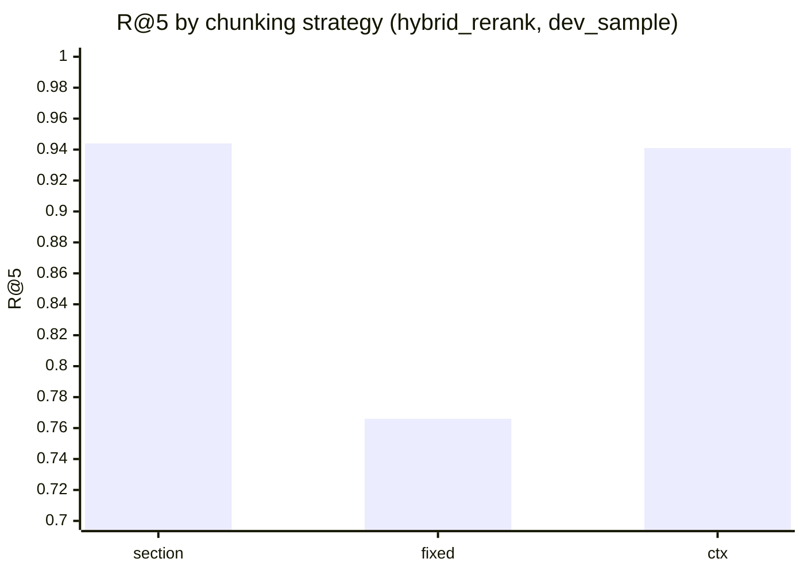
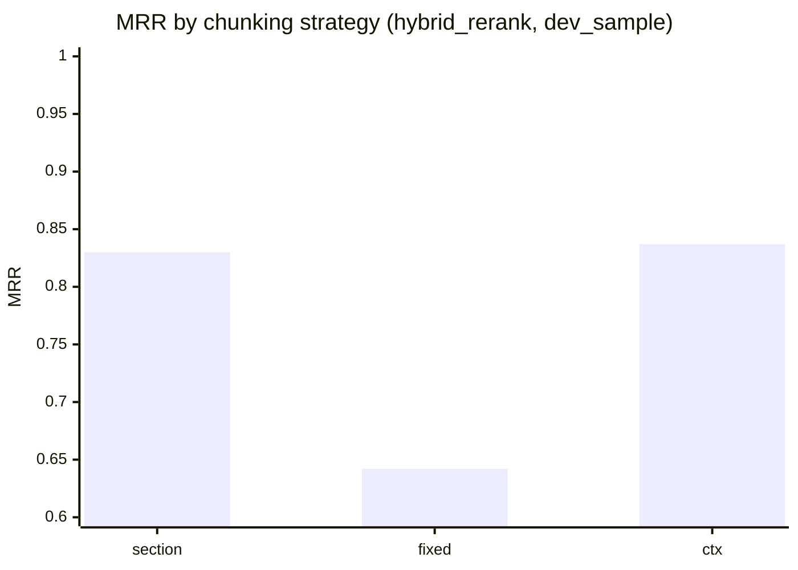

# M9 chunking benchmark on `dev_sample`

n = 303 queries, 100-paper dev_slice index per strategy. Commit `1c2eda7`. Source files: `results/m9_retrieval_section_dense_dev_sample.json`, `results/m9_retrieval_section_hybrid_rerank_dev_sample.json`, `results/m9_retrieval_fixed_dense_dev_sample.json`, `results/m9_retrieval_fixed_hybrid_rerank_dev_sample.json`, `results/m9_retrieval_ctx_dense_dev_sample.json`, `results/m9_retrieval_ctx_hybrid_rerank_dev_sample.json`.

## Retrieval

| Strategy | Method | R@5 | R@10 | MRR | nDCG@10 | Gold rank vs section |
|---|---|---|---|---|---|---|
| section | dense | 0.865 | 0.927 | 0.703 | 0.758 | – |
| fixed | dense | 0.700 | 0.769 | 0.526 | 0.585 | 44 better / 126 worse / 133 same |
| ctx | dense | 0.848 | 0.951 | 0.670 | 0.738 | 61 better / 80 worse / 162 same |
| section | hybrid_rerank | 0.944 | 0.970 | 0.830 | 0.865 | – |
| fixed | hybrid_rerank | 0.766 | 0.815 | 0.642 | 0.684 | 25 better / 108 worse / 170 same |
| ctx | hybrid_rerank | 0.941 | 0.980 | 0.837 | 0.872 | 36 better / 35 worse / 232 same |

Gold rank vs section: queries whose first gold chunk moved up / down in the top-10, same method.

## Ingest cost

| Strategy | Collection | Chunks | Ingest wall time | Enrichment |
|---|---|---|---|---|
| section | `dev_slice` | 6,740 | 3 min | none |
| fixed | `dev_slice_fixed` | 5,406 | 2 min | none |
| ctx | `dev_slice_ctx` | 6,740 | 188 min | 6453 calls, 5,170,549 in / 414,732 out tokens, 3.2 h LLM |

## By modality, hybrid_rerank (R@5 / MRR)

| Strategy | text (n=204) | text-image (n=72) | text-table (n=13) | text-table-image (n=14) |
|---|---|---|---|---|
| section | 0.961 / 0.857 | 0.903 / 0.760 | 0.923 / 0.832 | 0.929 / 0.784 |
| fixed | 0.760 / 0.658 | 0.750 / 0.599 | 0.846 / 0.654 | 0.857 / 0.615 |
| ctx | 0.946 / 0.851 | 0.931 / 0.766 | 0.846 / 0.833 | 1.000 / 1.000 |

## By question type, hybrid_rerank (R@5 / MRR)

| Strategy | abstractive (n=179) | extractive (n=124) |
|---|---|---|
| section | 0.922 / 0.800 | 0.976 / 0.873 |
| fixed | 0.793 / 0.657 | 0.726 / 0.621 |
| ctx | 0.922 / 0.797 | 0.968 / 0.894 |

## Charts

